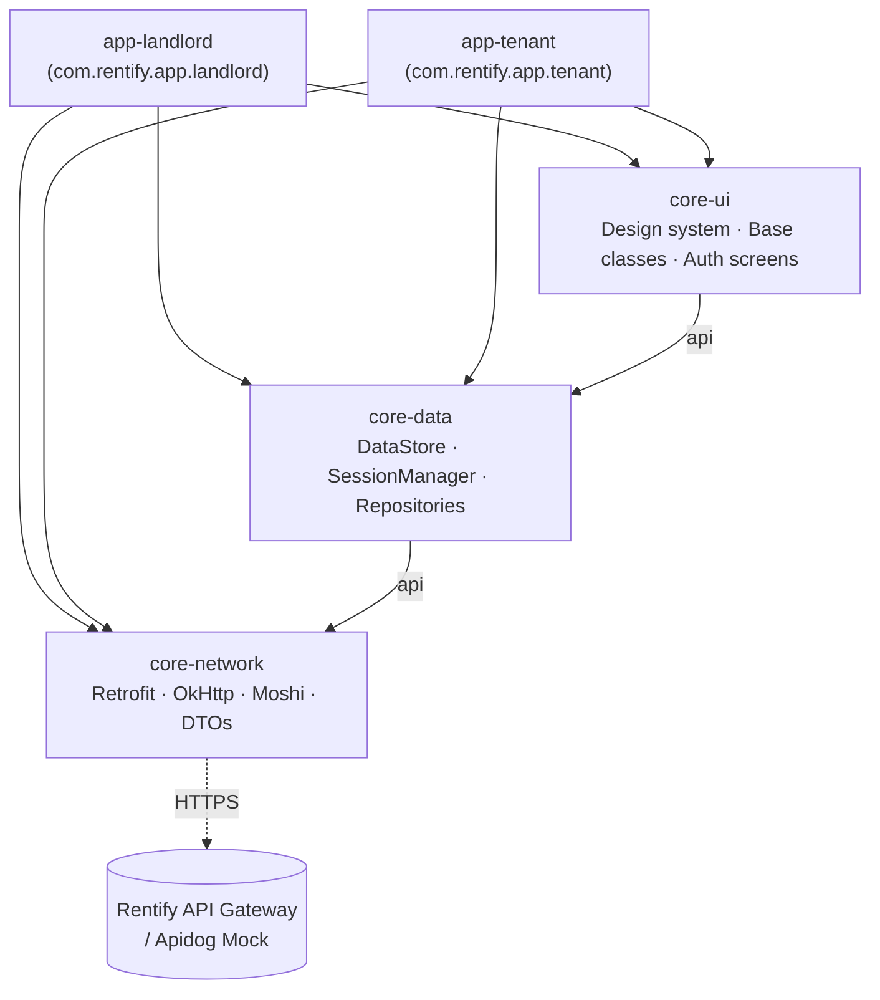
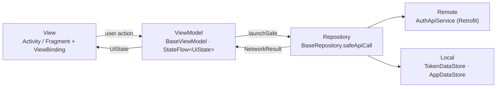

<div align="center">

<h1>Rentify · Mobile</h1>

<p>Ứng dụng Android native cho người thuê trọ và chủ trọ — Kotlin, XML Views, MVVM.</p>

<p>
  
  
  
  
  
  
  
  
  
  
  
</p>

<p>
  <a href="#giới-thiệu">Giới thiệu</a> •
  <a href="#tính-năng-nổi-bật">Tính năng</a> •
  <a href="#tech-stack">Tech stack</a> •
  <a href="#bắt-đầu-nhanh">Bắt đầu nhanh</a> •
  <a href="#cấu-hình">Cấu hình</a> •
  <a href="#lệnh-gradle">Lệnh Gradle</a> •
  <a href="#cấu-trúc-thư-mục">Cấu trúc</a> •
  <a href="#kiến-trúc">Kiến trúc</a> •
  <a href="#đóng-góp">Đóng góp</a>
</p>

</div>

---

## Giới thiệu

**Rentify Mobile** là bộ ứng dụng Android native trong hệ sinh thái **Rentify** — nền tảng quản lý nhà trọ cho thuê. Repo là một Gradle multi-module project (`rootProject.name = "Rentify"`) gồm **2 ứng dụng độc lập** dùng chung các module thư viện:

| Ứng dụng | Module | `applicationId` | Đối tượng |
|---|---|---|---|
| **Rentify Landlord** | `app-landlord` | `com.rentify.app.landlord` | Chủ trọ |
| **Rentify Tenant** | `app-tenant` | `com.rentify.app.tenant` | Người thuê |

Hai app được xây dựng bằng **Kotlin + XML Views** (không dùng Jetpack Compose), theo mô hình **MVVM**, gọi API qua **API Gateway** của Rentify theo hợp đồng OpenAPI trong repo [`be`](https://github.com/pbl6-home-renter/be).

> [!NOTE]
> Nhánh `main` hiện mới chỉ có module `core-ui` cùng hai app khung. Toàn bộ tầng network/data, luồng xác thực và onboarding đang nằm trên nhánh tích hợp **`develop`** (`core-network`, `core-data`, auth flow). README này mô tả trạng thái của `develop`.

## Tính năng nổi bật

**Đã hoàn thành** (trên `develop`)

- **Onboarding** 3 trang với animation Lottie (`assets/onboarding_*.json`) và `ViewPager2` + `ParallaxDepthPageTransformer`; chỉ hiển thị **một lần** sau khi cài đặt (cờ lưu trong `AppDataStore`).
- **Luồng xác thực đầy đủ** dùng chung cho cả hai app (đặt trong `core-ui`): Đăng nhập · Đăng ký (gửi `role` theo app) · Quên mật khẩu · Xác thực OTP · Đặt lại mật khẩu.
- **Auto-login**: khi mở app, `MainActivity` đọc access token trong `TokenDataStore` để điều hướng thẳng tới màn Home, Login hoặc Onboarding.
- **Lưu phiên đăng nhập** bằng Jetpack DataStore Preferences (`accessToken`, `refreshToken`, `userId`, `userRole`); đăng xuất xoá token nhưng giữ cờ onboarding.
- **Network layer** Retrofit + OkHttp + Moshi với `AuthInterceptor` (Bearer token) và `MaskedLoggingInterceptor` (che header `Authorization` khi log).
- **Design system** `Theme.Rentify` (Material 3, font Plus Jakarta Sans), giao diện **edge-to-edge**, các base class và extension dùng chung.

**Phạm vi dự kiến** (định hướng sản phẩm, chưa triển khai)

<details>
<summary>Xem danh sách tính năng theo từng app</summary>

**`app-landlord` — Chủ trọ**
- Quản lý toà nhà, dãy trọ, phòng trọ và trạng thái phòng.
- Quản lý hợp đồng cho thuê, thông tin khách thuê và tiền cọc.
- Lập và theo dõi hoá đơn hàng tháng (tiền nhà, điện, nước, dịch vụ).
- Tiếp nhận và xử lý sự cố / yêu cầu sửa chữa từ người thuê.

**`app-tenant` — Người thuê**
- Tìm kiếm phòng trọ, xem thông tin phòng và gửi yêu cầu thuê.
- Theo dõi chi tiết hợp đồng thuê phòng hiện tại.
- Tra cứu và thanh toán hoá đơn hàng tháng.
- Gửi báo cáo sự cố / yêu cầu hỗ trợ trực tiếp tới chủ trọ.

</details>

## Tech stack

| Hạng mục | Công nghệ | Phiên bản |
|---|---|---|
| Ngôn ngữ | Kotlin (Kotlin tích hợp sẵn trong AGP 9, không khai báo plugin riêng) | — |
| Build | Android Gradle Plugin · Gradle Wrapper · Version Catalog | `9.1.1` · `9.3.1` · `gradle/libs.versions.toml` |
| SDK | `compileSdk` 36.1 · `targetSdk` 36 · `minSdk` 26 | Java target `11` |
| UI | XML Views + ViewBinding, Material Components, ConstraintLayout, RecyclerView, ViewPager2 | Material `1.14.0` · ViewPager2 `1.1.0` |
| Animation | Lottie | `6.6.2` |
| Kiến trúc | MVVM — AndroidX Lifecycle (ViewModel, `lifecycleScope`), Fragment KTX | Lifecycle `2.8.7` · Fragment `1.8.6` |
| Bất đồng bộ | Kotlin Coroutines, Flow, StateFlow | `1.10.1` |
| Network | Retrofit + `converter-moshi`, OkHttp + `logging-interceptor`, Moshi (`moshi-kotlin`) | `2.11.0` · `4.12.0` · `1.15.2` |
| Lưu trữ local | Jetpack DataStore Preferences | `1.1.3` |
| Kiểm thử | JUnit 4, AndroidX Test JUnit, Espresso | `4.13.2` · `1.3.0` · `3.7.0` |

> [!NOTE]
> Dự án **không** dùng Jetpack Compose, Hilt/Dagger, Navigation Component hay Room. Dependency được khởi tạo thủ công (mỗi màn có một `ViewModelProvider.Factory`), điều hướng bằng `FragmentManager` trong `MainActivity` của từng app.

## Bắt đầu nhanh

### Yêu cầu

- **JDK 17** trở lên (bắt buộc để chạy AGP 9; có thể dùng JBR đi kèm Android Studio)
- **Android Studio** bản mới hỗ trợ AGP 9.1 (Jellyfish 2023.3.1 hoặc Ladybug trở lên theo ghi chú cũ của nhóm — nên dùng bản mới nhất)
- **Android SDK** Platform 36 (compileSdk 36.1)
- Thiết bị hoặc emulator chạy **Android 8.0 (API 26)** trở lên

### Cài đặt

```bash
git clone https://github.com/pbl6-home-renter/mobile.git
cd mobile
git checkout develop
```

Mở thư mục `mobile/` bằng Android Studio và chờ Gradle sync. Android Studio sẽ tự tạo `local.properties` (chứa `sdk.dir`) — file này đã nằm trong `.gitignore`.

### Cấu hình

Không cần biến môi trường hay file cấu hình bắt buộc để build. Mặc định app gọi tới **Apidog Mock Server** — xem mục [Cấu hình](#cấu-hình) để đổi base URL.

### Chạy

```bash
./gradlew :app-landlord:installDebug   # cài app Chủ trọ lên thiết bị đang kết nối
./gradlew :app-tenant:installDebug     # cài app Người thuê
```

Hoặc chọn run configuration `app-landlord` / `app-tenant` trong Android Studio rồi nhấn **Run**.

> [!NOTE]
> Trên Windows (PowerShell/CMD), thay `./gradlew` bằng `gradlew.bat` (ví dụ `gradlew.bat :app-tenant:assembleDebug`).

## Cấu hình

### Base URL của API

Base URL được khai báo trong `core-network/src/main/java/com/rentify/app/core/network/client/NetworkConfig.kt`:

```kotlin
data class NetworkConfig(
    val baseUrl: String = DEFAULT_BASE_URL,          // https://mock.apidog.com/m1/1370283-1374978-1459060/
    val connectTimeoutSeconds: Long = 30L,
    val readTimeoutSeconds: Long = 30L
)
```

Các màn hình auth tạo service qua `NetworkClient.createService<AuthApiService>()` với `NetworkConfig()` mặc định. Hiện chưa có `buildConfigField` hay product flavor nào cho base URL; muốn trỏ sang API Gateway thật thì truyền `NetworkConfig(baseUrl = "...")` hoặc sửa `DEFAULT_BASE_URL`.

> [!IMPORTANT]
> `/auth/refresh` và `/auth/logout` của backend kỳ vọng cookie `refreshToken` (HttpOnly). OkHttp client hiện **chưa có `CookieJar`** — cần bổ sung trước khi chạy với server thật (đang theo dõi trong `docs/PROJECT_LOG.md`).

### Build types & logging

- Chỉ có hai build type mặc định `debug` / `release`; `release` đang tắt minify (`isMinifyEnabled = false`), chưa cấu hình signing.
- `MaskedLoggingInterceptor` log toàn bộ body request/response (tag `NetworkLog`) và che header `Authorization`. Tham số `isDebug` mặc định là `true`, chưa gắn với `BuildConfig.DEBUG`.
- Không commit secret — cấu hình riêng tư đặt trong `local.properties` (đã ignore).

## Lệnh Gradle

Chạy tại thư mục gốc `mobile/` (Windows: `gradlew.bat`).

| Lệnh | Mô tả |
|---|---|
| `./gradlew :app-landlord:assembleDebug` | Build APK debug app Chủ trọ |
| `./gradlew :app-tenant:assembleDebug` | Build APK debug app Người thuê |
| `./gradlew :core-ui:assembleDebug` | Build AAR module `core-ui` |
| `./gradlew :core-ui:assembleDebug :app-landlord:assembleDebug :app-tenant:assembleDebug` | Build toàn bộ module chính |
| `./gradlew :app-landlord:installDebug` | Build và cài app Chủ trọ lên thiết bị |
| `./gradlew :app-tenant:installDebug` | Build và cài app Người thuê lên thiết bị |
| `./gradlew test` | Chạy unit test (JUnit) |
| `./gradlew connectedAndroidTest` | Chạy instrumented test (cần thiết bị/emulator) |
| `./gradlew clean` | Xoá thư mục build |

APK đầu ra nằm tại `<module>/build/outputs/apk/debug/`.

## Cấu trúc thư mục

```text
mobile/
├── app-landlord/                 # Application: Rentify Landlord (com.rentify.app.landlord)
│   └── src/main/
│       ├── assets/               # Lottie onboarding_1..3.json
│       └── java/.../landlord/
│           ├── MainActivity.kt   # Host fragment + điều hướng (onboarding → auth → home)
│           └── ui/onboarding/    # OnboardingFragment, OnboardingAdapter, OnboardingPage
├── app-tenant/                   # Application: Rentify Tenant (com.rentify.app.tenant) — cấu trúc tương tự
├── core-ui/                      # Library: design system + màn hình dùng chung (com.rentify.app.core.ui)
│   └── src/main/java/.../core/ui/
│       ├── base/                 # BaseActivity, BaseFragment, BaseViewModel, BaseListAdapter
│       ├── state/                # UiState (Idle / Loading / Success / Error)
│       ├── extension/            # InsetsExt, ViewExt, FormatExt
│       ├── component/            # LoadingDialog
│       ├── auth/                 # Login, Register, ForgotPassword, VerifyOtp, ResetPassword (+ ViewModel/Factory)
│       ├── home/                 # HomePlaceholderFragment
│       └── transformer/          # ParallaxDepthPageTransformer
├── core-data/                    # Library: DataStore, session, repository (com.rentify.app.core.data)
│   └── src/main/java/.../core/data/
│       ├── local/datastore/      # TokenDataStore, AppDataStore
│       ├── local/session/        # SessionManager
│       ├── model/                # UserSession
│       └── repository/           # BaseRepository (safeApiCall), auth/AuthRepository(+Impl), TokenRepository
├── core-network/                 # Library: Retrofit/OkHttp/Moshi (com.rentify.app.core.network)
│   └── src/main/java/.../core/network/
│       ├── client/               # NetworkClient, NetworkConfig (base URL, timeout)
│       ├── api/                  # AuthApiService
│       ├── dto/                  # ApiSingleResponse, ApiListResponse, ApiErrorResponse, auth/, user/
│       ├── interceptor/          # AuthInterceptor, MaskedLoggingInterceptor
│       └── adapter/              # NetworkResult (Success / ApiError / NetworkError / UnknownError)
├── docs/PROJECT_LOG.md           # Nhật ký quyết định, vấn đề mở, thay đổi lớn
├── gradle/libs.versions.toml     # Version Catalog — nơi duy nhất khai báo version thư viện
├── AGENTS.md                     # Quy tắc làm việc cho AI agent trong repo
├── build.gradle.kts              # Root build
└── settings.gradle.kts           # Khai báo module
```

## Kiến trúc

### Sơ đồ phụ thuộc module

Mỗi app phụ thuộc trực tiếp vào cả ba module core; giữa các module core, dependency được expose qua `api(...)` theo chuỗi `core-ui → core-data → core-network`.



### Các tầng MVVM



- **View** — `BaseActivity<VB>` / `BaseFragment<VB>` khởi tạo ViewBinding, gọi `initView()` + `observeData()`, collect state an toàn theo lifecycle (`collectWhenStarted`) và render bằng `renderState(state, onError, onSuccess)` (tự bật/tắt `LoadingDialog`). Fragment báo sự kiện điều hướng lên Activity qua **listener interface** (ví dụ `LoginFragment.LoginListener`) để không mất callback khi recreate.
- **ViewModel** — kế thừa `BaseViewModel`, dùng `launchSafe` (tự catch exception, re-throw `CancellationException`) và phát `UiState<T>`. Được tạo qua `ViewModelProvider.Factory` (DI thủ công).
- **Repository** — `BaseRepository.safeApiCall` chuyển `retrofit2.Response` thành `NetworkResult`, parse `ApiErrorResponse` từ error body và coi `204 No Content` là `Success(Unit)`. `AuthRepositoryImpl` lưu token vào `TokenDataStore` sau khi đăng nhập và xoá khi logout/refresh thất bại.

<details>
<summary>Chi tiết module <code>core-ui</code> (<code>com.rentify.app.core.ui</code>)</summary>

**Base classes — `base/`**
- `BaseActivity<VB : ViewBinding>`: kế thừa `AppCompatActivity`, tự gọi `enableRentifyEdgeToEdge()`, khởi tạo ViewBinding, điều phối `initView()` / `observeData()`, hỗ trợ `collectWhenStarted`, `showLoading()` / `hideLoading()` qua `LoadingDialog`.
- `BaseFragment<VB : ViewBinding>`: quản lý ViewBinding theo lifecycle an toàn, cung cấp `renderState(state, onError, onSuccess)`.
- `BaseViewModel`: `launchSafe` tự catch exception và re-throw `CancellationException`.
- `BaseListAdapter<T, VB>`: kế thừa `ListAdapter`, chống spam click (`setOnSingleClickListener`), helper `simpleDiff` tạo nhanh `DiffUtil.ItemCallback`.

**State — `state/UiState.kt`**: sealed interface `Idle` · `Loading` · `Success<T>(data)` · `Error(message)`.

**Extensions — `extension/`**
- `InsetsExt.kt`: `Activity.enableRentifyEdgeToEdge()` (thanh hệ thống trong suốt, icon tối), `View.applySystemBarsPadding()` (giữ padding gốc), `View.applyImePadding()` (padding khi mở bàn phím).
- `ViewExt.kt`: `visible()`, `gone()`, `invisible()`, `showIf(condition)`, `setOnSingleClickListener(intervalMs)`, `toast()` và `hideKeyboard()` cho `Fragment` / `Activity`.
- `FormatExt.kt`: `Long.toVnd()` / `Double.toVnd()` → `"1.500.000 đ"`; `String.toDisplayDate()` → `"03/10/2026"`; `toDisplayDateTime()` → `"03/10/2026 10:15"`; `toDisplayMonth()` → `"10/2026"`.

**Components & resources**
- `LoadingDialog`: `DialogFragment` nền trong suốt chứa `CircularProgressIndicator` Material 3 bo góc.
- `Theme.Rentify`: bảng màu `rentify_*`, style mặc định cho `MaterialButton`, `TextInputLayout`, `MaterialCardView`, kiểu chữ `TextAppearance.Rentify.*`, font Plus Jakarta Sans.
- Layout dùng chung: `view_empty_state.xml`, `view_error_state.xml` (kèm nút thử lại), `dialog_loading.xml`.

</details>

## API / Tài liệu

- **Hợp đồng API**: nguồn đặc tả duy nhất là OpenAPI trong repo [`be`](https://github.com/pbl6-home-renter/be) (`reference/rentify.json`, đồng bộ lên Apidog). Không tự thêm endpoint hay field ngoài spec.
- **Endpoint đang dùng** (`AuthApiService`): `POST auth/register`, `auth/login`, `auth/refresh`, `auth/logout`, `auth/password-reset-requests`, `auth/password-resets`.
- **Envelope**: response bọc trong `ApiSingleResponse` / `ApiListResponse`, lỗi trong `ApiErrorResponse` theo quy ước của `be`.
- **Tài liệu nội bộ**: [`docs/PROJECT_LOG.md`](docs/PROJECT_LOG.md) (quyết định, vấn đề mở, thay đổi lớn) và [`AGENTS.md`](AGENTS.md) (quy tắc làm việc, bảo mật, git).

## Đóng góp

1. Tạo nhánh từ `develop` theo mẫu `feature/<id>-<slug>` (hoặc `fix/`, `hotfix/`, `docs/`, `ci/`), trong đó `<id>` là mã task theo `pm/phase-N/issues/`, ví dụ `feature/p6-08-room-list`.
2. Commit message bằng tiếng Anh theo **Conventional Commits** (ví dụ `feat(auth): ...`, `style(ui): ...`, `docs: ...`).
3. Trước khi mở PR, đảm bảo các app build được: `./gradlew :app-landlord:assembleDebug :app-tenant:assembleDebug`.
4. Mở Pull Request vào `develop`, cần **ít nhất 1 reviewer**, merge bằng **squash**. `develop` được gộp vào `main` khi phát hành.

> [!WARNING]
> Không push trực tiếp lên `main` hoặc `develop`. Không thêm thư viện mới hay sửa file Gradle khi chưa thống nhất với nhóm; mọi version khai báo trong `gradle/libs.versions.toml`. Không log token, mật khẩu, số CCCD hay số tài khoản ngân hàng.

## Hệ sinh thái Rentify

| Repo | Vai trò |
|---|---|
| [`api-gateway`](https://github.com/pbl6-home-renter/api-gateway) | Reverse proxy: định tuyến theo prefix, xác thực JWT/JWKS, rate limit |
| [`Identity-Service`](https://github.com/pbl6-home-renter/Identity-Service) | Xác thực, người dùng, hồ sơ chủ trọ; phát hành JWT RS256 |
| [`Tenancy-Service`](https://github.com/pbl6-home-renter/Tenancy-Service) | Tòa nhà, phòng, đơn vị hành chính |
| [`boilerplate`](https://github.com/pbl6-home-renter/boilerplate) | Template NestJS mà mọi backend service được fork từ |
| [`be`](https://github.com/pbl6-home-renter/be) | Hợp đồng OpenAPI 3.0 chuẩn (canonical) |
| [`fe`](https://github.com/pbl6-home-renter/fe) | Web cho chủ trọ (React + Vite) |
| [**`mobile`**](https://github.com/pbl6-home-renter/mobile) | Ứng dụng Android cho người thuê & chủ trọ |
| [`infra`](https://github.com/pbl6-home-renter/infra) | Docker Compose + Caddy cho hai host EC2 |

## Giấy phép

Dự án học thuật thuộc học phần PBL6 — Trường Đại học Bách khoa, Đại học Đà Nẵng. Chưa phát hành theo giấy phép mã nguồn mở.
